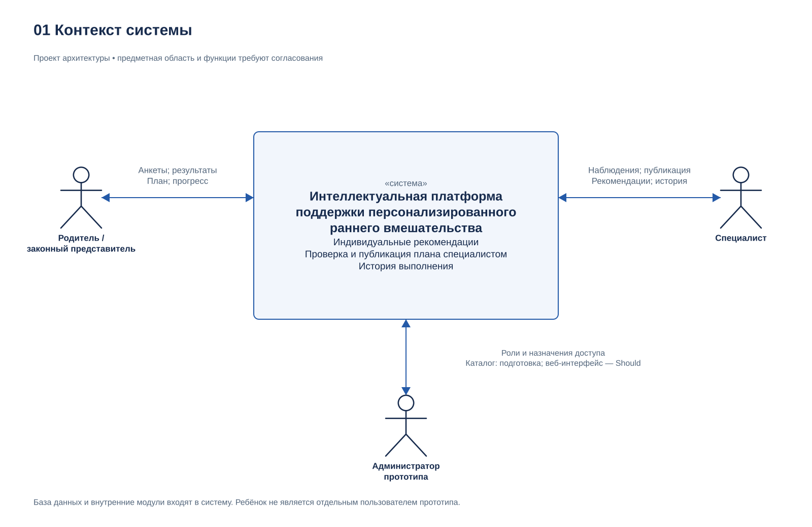
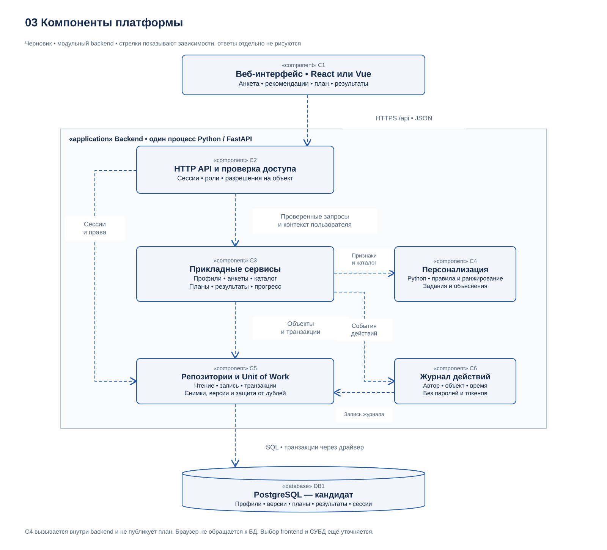
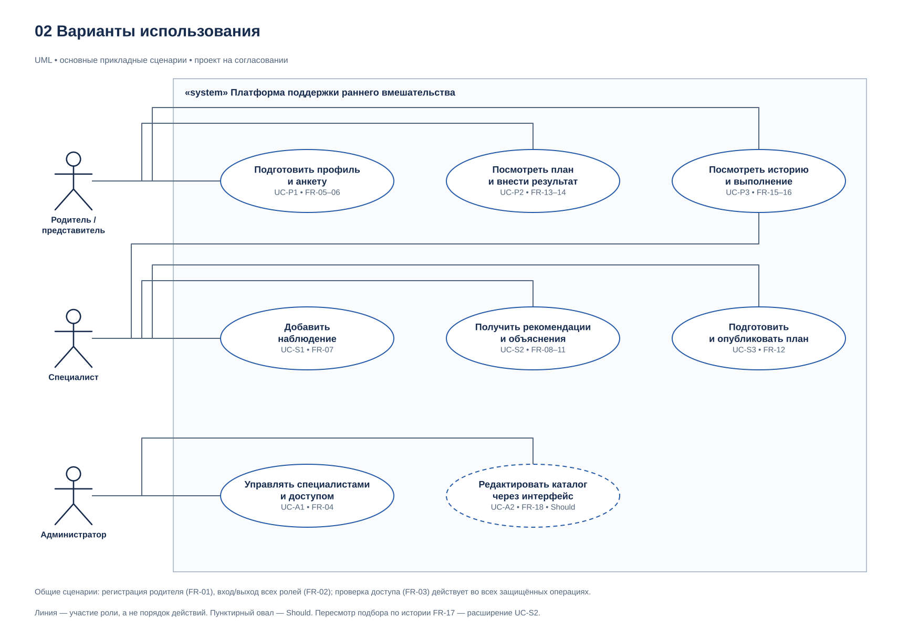

# Архитектура платформы и диаграммы

## 1. Назначение и статус

Проект: «Разработка интеллектуальной платформы поддержки персонализированного раннего вмешательства».

Статус: проект архитектуры для обсуждения, а не описание уже реализованной системы. Основание — первоначальная спецификация с FR-01–FR-19 и NFR-01–NFR-11. При последующих изменениях требований необходимо обновлять документ и диаграммы.

Предметная область предварительно трактуется как ранняя помощь детям при участии специалиста и родителя или законного представителя. Направление поддержки, возраст, содержание анкет и критерии подбора требуют подтверждения руководителя и исследования пользователей. Для демонстрации предполагаются учебные данные.

Сервер предлагается реализовать на Python/FastAPI с учётом опыта Рамазана; Python соответствует опыту Даурена. React или Vue выбирает Алишер. PostgreSQL пока является кандидатом; окончательное решение о СУБД и размещении требуется зафиксировать отдельно.

Связанная задача: Prepare architecture and diagrams. Перед публикацией необходимо указать фактический номер задачи YouTrack.

## 2. Контекст и пользователи

С точки зрения пользователей платформа является одной системой. На контекстной диаграмме её внутренние компоненты не раскрываются.

| Участник | Взаимодействие с системой | Граница ответственности |
| --- | --- | --- |
| Родитель или законный представитель | Заполнение анкеты, просмотр опубликованного плана, фиксация выполнения, просмотр истории | Работает только с разрешённым профилем; не утверждает план |
| Специалист | Наблюдения, запрос рекомендаций, проверка и публикация плана, просмотр результатов | Работает только с назначенными профилями; решение о публикации принимает явно |
| Администратор прототипа | Учётные записи специалистов, роли, назначения доступа, подготовка каталога | Административные функции доступны только с соответствующими полномочиями; отдельный веб-интерфейс каталога относится к Should |

Ребёнок является субъектом сведений профиля, а не отдельным авторизованным пользователем в этой версии. GitHub и YouTrack используются для разработки; они не участвуют в рабочем сценарии платформы. Внешние медицинские системы, почтовые сервисы, внешние ML API и платежи не являются обязательными зависимостями.

Редактируемый исходник: [system-context.drawio](../diagrams/system-context.drawio). Изображение для отчёта: [system-context.png](../diagrams/system-context.png).

## 3. Архитектурный подход

Предлагается модульное серверное приложение: HTTP API, прикладные сервисы, модуль персонализации и доступ к данным находятся в одном backend-проекте и могут запускаться одним процессом. Пользовательский интерфейс обращается к API, а сервер работает с базой данных.

Причины выбора:

1. Команда состоит из трёх участников; для прототипа не требуется инфраструктура нескольких сервисов.
2. Backend и модуль персонализации могут использовать Python и согласованный интерфейс вызова функций.
3. Разделение на модули сохраняет самостоятельные зоны ответственности и возможность заменить алгоритм без изменения интерфейса пользователя.
4. Версии планов и результаты можно сохранять в одной транзакционной базе.

Это проектные доводы. Снижение сроков и производительность пока не измерялись. Выделение персонализации в отдельный сервис рассматривается только при подтверждённой необходимости, например независимом развёртывании или длительных вычислениях.

## 4. Компоненты и ответственность

| ID | Компонент | Ответственность | Основной исполнитель |
| --- | --- | --- | --- |
| C1 | Веб-интерфейс | Кабинеты, анкета, план, ввод результатов, отображение загрузки и ошибок; клиентская проверка для удобства | Алишер |
| C2 | HTTP API и проверка доступа | Маршруты, схемы запросов и ответов, вход и выход, проверка сессии, роли и разрешения на конкретный объект | Рамазан |
| C3 | Прикладные сервисы | Профили, анкеты, наблюдения, каталог, организация подбора, версии планов, результаты и расчёт прогресса | Рамазан; контракты согласуются с командой |
| C4 | Модуль персонализации | Проверка достаточности признаков, отбор и ранжирование, объяснение выбора; учёт истории — Should | Даурен |
| C5 | Репозитории и единица работы | Чтение и запись данных, согласованные транзакции, уникальность результатов, сохранение снимков и версий | Рамазан |
| C6 | Журнал действий | Подготовка записей об административных действиях и публикации плана с автором, объектом и временем | Рамазан |
| DB1 | База данных | Учётные записи, сессии, связи доступа, профили, версии анкет и каталога, рекомендации, планы, результаты и журнал | Рамазан |

C3 логически разделяется на модули Profiles, Questionnaires, Catalog, Plans и Progress. На диаграмме они объединены в один компонент, чтобы показать основные зависимости без детализации каждого класса. C4 не обращается к браузеру и не записывает планы напрямую в БД. C3 передаёт ему подготовленные данные и сохраняет результат через C5.

Редактируемый исходник: [components.drawio](../diagrams/components.drawio). Изображение для отчёта: [components.png](../diagrams/components.png).

Стрелки на этой диаграмме показывают основные зависимости вызывающего компонента от вызываемого; возвращаемые ответы отдельно не рисуются. Прямое обращение браузера к БД не предусмотрено. Проверки прав C2 и предметных ограничений C3 выполняются до защищённых действий. На схеме отдельно показана зависимость C2 от C5 для хранения и проверки сессий и доступа.

## 5. Варианты использования

Редактируемый исходник: [use-cases.drawio](../diagrams/use-cases.drawio). Изображение для отчёта: [use-cases.png](../diagrams/use-cases.png).

Диаграмма использует акторов, овалы вариантов использования и границу системы. Линия означает участие роли, а не последовательность действий. В этой укрупнённой диаграмме регистрация FR-01 и вход/выход FR-02 описаны как общие учётные сценарии в таблице ниже; контроль доступа FR-03 применяется ко всем защищённым сценариям. Пунктирный овал обозначает приоритет Should, что является локальным условным обозначением этой диаграммы.

| ID сценария | Сценарий и роль | Требования |
| --- | --- | --- |
| UC-P1 | Родитель подготавливает профиль и анкету | FR-05, FR-06 |
| UC-P2 | Родитель просматривает опубликованный план и фиксирует выполнение | FR-13, FR-14 |
| UC-P3 | Родитель и назначенный специалист просматривают историю и выполнение | FR-15, FR-16 |
| UC-S1 | Специалист добавляет наблюдение | FR-07 |
| UC-S2 | Специалист запрашивает рекомендации и объяснения | FR-08, FR-09, FR-10, FR-11; пересмотр по истории FR-17 — Should |
| UC-S3 | Специалист готовит и публикует план | FR-12 |
| UC-A1 | Администратор управляет специалистами и назначениями доступа | FR-04 |
| UC-A2 | Администратор редактирует каталог через интерфейс | FR-18 — Should; подготовка начального каталога FR-08 возможна без веб-интерфейса |
| UC-G1 | Родитель регистрируется; все роли входят и выходят | FR-01, FR-02; общие сценарии, отдельно не показанные овалами |

Выгрузка FR-19 имеет приоритет Could и в основную диаграмму не включена. Если её включат в объём, потребуется добавить вариант использования и проверку доступа к выгружаемому плану.

## 6. Предлагаемые интерфейсы

### 6.1. Веб-интерфейс и API

Предлагается обмен JSON по HTTP API под префиксом `/api`. При сетевом размещении используется HTTPS. Список ниже является черновиком контракта, а не перечнем существующих маршрутов.

| Операция | Предлагаемый маршрут | Кто имеет доступ | Проверки и требования |
| --- | --- | --- | --- |
| Регистрация | POST /api/auth/register | Неавторизованный пользователь | Создаётся только роль родителя; FR-01 |
| Вход и выход | POST /api/auth/login; POST /api/auth/logout | Пользователь / активная сессия | Проверка учётных данных и отзыв текущей сессии; FR-02 |
| Профили | POST /api/profiles; GET/PATCH /api/profiles/{id} | Родитель; чтение назначенным специалистом | При создании привязка к родителю; изменение полей по роли; FR-03, FR-05 |
| Анкеты | POST /api/profiles/{id}/questionnaires; GET /api/profiles/{id}/questionnaires/latest | Родитель; чтение назначенным специалистом | Структура, версия, принадлежность профилю; FR-06 |
| Наблюдения | POST/GET /api/profiles/{id}/observations | Назначенный специалист | Автор и время; состав сведений для родителя уточняется отдельно; FR-07 |
| Каталог | GET /api/catalog | Специалист | Доступные задания из выбранной версии; FR-08 |
| Подбор | POST /api/profiles/{id}/recommendations | Назначенный специалист | Доступ к профилю, достаточность данных; FR-09–FR-11 |
| Черновик плана | POST /api/profiles/{id}/plans; PATCH /api/plans/{id} | Назначенный специалист | Подбор, если указан, относится к тому же профилю; редактируется только черновик; FR-12 |
| Публикация | POST /api/plans/{id}/publish | Назначенный специалист | Явное утверждение и атомарное сохранение снимков; FR-12, FR-15 |
| Просмотр планов | GET /api/profiles/{id}/plans; GET /api/plans/{id} | Родитель и назначенный специалист | Родителю доступны опубликованные и исторические версии, но не черновики; FR-13, FR-15 |
| Результат | POST /api/plan-items/{id}/result | Родитель доступного профиля | Одна итоговая запись на пункт; обработка повторной отправки; FR-14 |
| Прогресс | GET /api/profiles/{id}/progress?plan_version_id=... | Родитель и назначенный специалист | Проверка принадлежности версии и формулы; FR-16 |
| Администрирование | POST /api/admin/specialists; POST /api/admin/profile-assignments; DELETE /api/admin/profile-assignments/{id} | Администратор | Роль, назначение и отзыв доступа с журналированием; FR-04 |

Ошибки имеют единый формат с кодом, сообщением и, при необходимости, ошибками полей. Для недопустимого ввода предлагается 422, для отсутствующей или отозванной сессии 401, для запрещённого действия 403 либо 404 по согласованной политике раскрытия существования объекта, для конфликта состояния 409. Приёмочные проверки учитывают документированную политику.

Отсутствие признаков для подбора отличается от повреждённого HTTP-запроса: корректный запрос может вернуть `status: insufficient_data`, список недостающих полей и пустой список рекомендаций. UI не представляет такой ответ как готовый план.

### 6.2. Контракт модуля персонализации

| Вход | Выход |
| --- | --- |
| Снимок разрешённых признаков профиля, версия и ответы анкеты, согласованные наблюдения, выбранная версия каталога и правил; история выполнения при включении FR-17 | Статус, список недостающих признаков, список заданий с порядком и объяснениями, версии каталога и алгоритма |

API не передаёт C4 пароли, сессии или сведения, не нужные для согласованных правил. C4 возвращает предложение; он не утверждает и не публикует план. C3 сохраняет входной снимок, версии и результат под идентификатором запуска подбора. Порядок ранжирования и разрешение одинаковых оценок фиксируются в описании алгоритма.

В первой версии допускается детерминированный алгоритм правил. Подключение обученной модели не является обязательной архитектурной зависимостью. Состав библиотек, допустимые признаки и правила согласуются отдельно.

## 7. Данные и согласованность

Предлагаемые группы данных:

- `users`, `sessions` — учётные записи, роли, хеши паролей, сессии и их отзыв;
- `profiles`, `profile_assignments` — признаки профиля, родитель и назначение специалиста;
- `questionnaire_versions`, `answer_sets`, `observations` — структуры анкет, версии ответов и записи специалиста;
- `catalog_versions`, `task_definitions` — каталог и условия применимости заданий;
- `recommendation_runs` — входные снимки, версии алгоритма и каталога, предложения и объяснения;
- `plan_versions`, `plan_items` — состояние и зафиксированное содержимое плана;
- `task_results` — итог по конкретному пункту плана;
- `audit_events` — автор, действие, объект и время значимых операций.

Это проектная модель, а не уже созданная схема БД. Для демонстрационного профиля предполагается один родитель и один активный назначенный специалист, как в requirements.md.

Предлагаемые правила согласованности:

1. Профиль, анкета, запуск подбора, версия плана и результаты связываются через идентификаторы и проверяются на принадлежность одному профилю.
2. Публикация плана сохраняет заголовок версии, пункты, инструкции-снимки, ссылки на основания и событие журнала в одной транзакции. Частичная публикация откатывается.
3. Опубликованная версия не редактируется. Корректировка начинается с нового черновика. Предыдущие версии и результаты сохраняются.
4. Предлагаемые состояния: Draft → Published → Archived. Архивная версия остаётся доступной в истории. Для прототипа предлагается одна текущая опубликованная версия на профиль; это правило ещё требуется согласовать.
5. Изменение каталога не меняет инструкции в уже опубликованных планах.
6. На пункт плана допускается одна итоговая запись. Повтор идентичного запроса возвращает существующий результат; несовместимый повтор отклоняется как конфликт. Это необходимо проверять также при конкурентных запросах.
7. Итоги C, S, R и процент выполнения рассчитываются из сохранённых результатов выбранной версии по формулам requirements.md. Они не являются оценкой развития ребёнка.
8. Правила внешних ключей, удаления и миграций определяются при разработке схемы. Удаление исторических результатов каскадом без отдельного согласованного решения не предполагается.

## 8. Основные потоки выполнения

### Анкета

Родитель → C1 → C2: запрос с данными. C2 проверяет сессию, схему и принадлежность профиля. C3 проверяет предметные ограничения и выбранную версию анкеты. C5 сохраняет данные в DB1. Только после подтверждения сервера C1 сообщает об успешном сохранении.

### Подбор и публикация

Специалист → C1 → C2: запрос подбора. После проверки назначения C3 получает через C5 признаки и версию каталога, вызывает C4 и сохраняет предложение. Специалист просматривает объяснения и редактирует черновик. Отдельный запрос публикации выполняет проверки, транзакционную запись через C5 и журналирование через C6. До публикации родитель новый план не видит.

### Выполнение и прогресс

Родитель → C1 → C2: результат пункта. C2/C3 проверяют доступ, принадлежность опубликованному плану и допустимое состояние. C5 обеспечивает единственность записи. C3 вычисляет показатели выбранной версии. При повторной отправке система не увеличивает число результатов.

### Администрирование

Администратор использует закрытый CLI-клиент, обращающийся к административным операциям API с административной учётной записью, либо согласованный интерфейс. Изменения ролей и назначений проходят те же серверные проверки и журналирование. Первичная подготовка администратора и учебных данных выполняется отдельной процедурой развёртывания. Прямое редактирование рабочих таблиц не является пользовательским сценарием.

## 9. Доступ, размещение и эксплуатация

- Для браузерного прототипа предлагаются серверные сессии с отзываемым идентификатором и хранением состояния в DB1. Это позволяет явно выполнять требование выхода FR-02. Реализацию аутентификации ещё необходимо выбрать и проверить.
- При использовании cookie предлагаются HttpOnly, Secure при HTTPS, согласованная SameSite-политика и защита изменяющих запросов от CSRF. Эти меры являются проектными требованиями к реализации, а не заявлением о проведённом аудите.
- Проверяется не только роль, но и назначение на профиль, его связанные объекты и допустимое состояние операции. Скрытие кнопки в UI не заменяет серверного запрета.
- В журнале не сохраняются пароли, токены и полные тексты анкет. Административные права не используются как обычный сценарий родителя или специалиста.
- Предлагаемая схема размещения: браузер → единая HTTPS-точка входа → статические файлы C1 и `/api` C2 → DB1 в закрытом контуре доступа. HTTPS может обеспечиваться выбранной средой размещения; конкретный продукт пока не выбран.
- Для локальной демонстрации возможны отдельные процессы frontend, backend и БД; адреса и разрешённые источники настраиваются явно. CORS сам по себе не заменяет проверку доступа.
- Реальные секреты не попадают в Git. README содержит пример конфигурации без действующих значений, порядок подготовки схемы и учебных данных и инструкции запуска.
- Redis, брокер сообщений, фоновые работники, внешние ML-сервисы и микросервисы не включены в обязательную архитектуру. Их необходимость требует отдельного обоснования.
- Ограничения времени ответа NFR-06 проверяются на фактической среде. Диаграммы не подтверждают достижение целевых показателей.

Технические ориентиры для дальнейшей реализации: [OWASP — управление сессиями](https://cheatsheetseries.owasp.org/cheatsheets/Session_Management_Cheat_Sheet.html) и [OWASP — защита от CSRF](https://cheatsheetseries.owasp.org/cheatsheets/Cross-Site_Request_Forgery_Prevention_Cheat_Sheet.html). Это источники для проектирования и проверки, а не подтверждение соответствия ещё не реализованного приложения.

## 10. Связь требований с компонентами

| Требования | Компоненты | Проектное решение |
| --- | --- | --- |
| FR-01, FR-02 | C1, C2, C5, DB1 | Регистрация только родителя, сессия, вход и отзыв при выходе |
| FR-03, FR-04 | C2, C3, C5, C6, DB1 | Проверка роли и назначения на профиль; журнал административных действий |
| FR-05, FR-06, FR-07 | C1, C2, C3, C5, DB1 | Профиль, версия анкеты и наблюдения с автором |
| FR-08, FR-09, FR-10, FR-11 | C2, C3, C4, C5, DB1 | Версия каталога, объяснимый подбор, недостаточность данных |
| FR-12, FR-13, FR-15 | C1, C2, C3, C5, C6, DB1 | Явная публикация, снимки инструкций, транзакция и история версий |
| FR-14, FR-16 | C1, C2, C3, C5, DB1 | Один итог на пункт, защита от дублей и расчёт по версии плана |
| FR-17 | C3, C4, C5 | История во входе подбора при включении Should |
| FR-18 | C1, C2, C3, C5, C6 | Административный интерфейс каталога при включении Should |
| FR-19 | C1, C2, C3 | Выгрузка только разрешённой версии при включении Could |
| NFR-01, NFR-07 | C2, C3, C5, C6, DB1 и размещение | Сессии, библиотечное хеширование, HTTPS, секреты и журнал |
| NFR-02 | C2, C3, C5, DB1 | Серверная валидация, ограничения и транзакции |
| NFR-03, NFR-04, NFR-05, NFR-09 | C1, C2 | Сообщения об ошибках, адаптивность, клавиатура и браузеры |
| NFR-06 | C1–C5, DB1 и размещение | Измерение API в заданных условиях, а не предположение о быстродействии |
| NFR-08, NFR-10 | Все компоненты | Зависимости, README, пример конфигурации и учебный набор |
| NFR-11 | C5, DB1 и процедура эксплуатации | Проверяемые экспорт и восстановление при включении Should |

Таблица описывает проектное покрытие требований. Факт реализации и успешной проверки должен подтверждаться отдельно.

## 11. Файлы диаграмм и редактирование

| Диаграмма | Редактируемый исходник | Векторное изображение | Изображение для отчёта |
| --- | --- | --- | --- |
| System Context Diagram | ../diagrams/system-context.drawio | ../diagrams/system-context.svg | ../diagrams/system-context.png |
| Use Case Diagram | ../diagrams/use-cases.drawio | ../diagrams/use-cases.svg | ../diagrams/use-cases.png |
| Component Diagram, draft | ../diagrams/components.drawio | ../diagrams/components.svg | ../diagrams/components.png |

Исходники .drawio содержат отдельные редактируемые фигуры, подписи и связи. Их можно открыть в draw.io/diagrams.net. SVG и PNG подготовлены из той же модели расположения; это статические изображения для просмотра и включения в отчёт. После изменения исходника необходимо заново экспортировать изображения и проверить совпадение подписей и связей.

Справка формата: [официальное описание draw.io XML](https://www.drawio.com/docs/reference/diagram-generation/). В репозиторий нужно добавить и исходники, и изображения, сохранив относительные пути.

## 12. Открытые решения и проверка командой

До утверждения требуется уточнить предметную область, роли специалистов, возраст, содержание данных и каталога, выбор React/Vue и СУБД, хранение сессий, среду размещения и включение Should/Could.

Алишер проверяет роли, сценарии, состояния UI и взаимодействие с API. Даурен проверяет контракт C4, достаточность данных, объяснения и версии алгоритма. Рамазан проверяет доступ, транзакции, сохранение истории и соответствие требованиям. Каждый участник фиксирует реальные замечания или результат проверки в Pull Request; согласование руководителя фиксируется отдельно.

Критерии готовности этого комплекта: три диаграммы читаемы; исходники редактируемы; относительные ссылки работают после загрузки; названия ролей и компонентов совпадают; все FR/NFR имеют строку в таблице покрытия; предположения отмечены; результат проверки команды сохранён. Реализация приложения для подготовки комплекта не требуется.
