# DIP-8 — кликабельный прототип интерфейса «Рядом»

Дата: **23 октября 2026, Asia/Almaty**.

Связанная задача: [DIP-8](https://kantayevr.youtrack.cloud/issue/DIP-8).

## Ссылка и доступ

[Открыть прототип «Рядом»](https://ryadom-dip8-prototype-oct23.giving-haven-5255.chatgpt.site)

Развёртывание подтверждено сервисом: `succeeded`, 23.10.2026. **Сейчас доступ приватный — владельцу. Доступ команды ещё не настроен:** нужно выбрать просмотр по ссылке либо назвать участников. До этого требование общего доступа к просмотру не закрыто.

Независимая локальная копия находится в `prototype/`. Из корня пакета можно запустить `python3 -m http.server 4173 --directory prototype` и открыть `http://localhost:4173`. Сервер лишь раздаёт статические файлы; прикладного backend нет. Данные сохраняются в браузере. На другом устройстве будет отдельная демонстрация.

Тема ранней помощи и взаимодействия родителя со специалистом — **предположение до подтверждения руководителем**. Название, имена, возраст, наблюдения и задания вымышлены. Содержание заданий иллюстрирует интерфейс и не является персональной рекомендацией.

## Сценарий 1 — специалист

1. На входе выбрать **«Специалист» → «Войти в демо»**.
2. В профиле просмотреть анкету, интересы, запрос и наблюдения.
3. Нажать **«Посмотреть предложения»**. У каждого предложения есть объяснение.
4. Нажать **«Проверить и изменить»**. Изменить название, инструкцию или длительность; при необходимости убрать задание.
5. Можно **сохранить черновик**. Он не становится опубликованным планом.
6. Отметить **«Я проверил(а) все задания…»**, нажать **«Опубликовать план»**. Без подтверждения публикация блокируется.
7. Открывается опубликованная версия с подтверждением успешного действия.

Начальное демо содержит заполненную анкету и не содержит опубликованного плана. Для повторного запуска: нижняя панель «Проверка прототипа» → «Сценарий специалиста с начала». Эта команда сбрасывает демонстрационные данные.

## Сценарий 2 — родитель, продолжение первого

1. После публикации нажать **«Сменить роль»**, выбрать **«Родитель» → «Войти в демо»**. Не сбрасывать демо между сценариями.
2. Открывается именно опубликованная версия. Кнопок редактирования черновика и публикации нет.
3. Отметить первое задание **«Выполнено»**, второе **«Пропущено»**.
4. Сводка сразу показывает **1 выполнено, 1 пропущено, 1 без отметки** для плана из трёх заданий.
5. Нажать **«История и сводка»** — видны публикация, обе отметки и **33,3% заданий выполнено**.
6. Отметку можно изменить или снять; сводка пересчитывается. Сохранённые данные остаются после перезагрузки.

Процент = выполненные задания / все задания текущей опубликованной версии × 100, округление до одного знака после запятой согласно разделу 7 [требований](requirements.md). При отсутствии плана показано «Нет назначенных заданий». Пропущенные задания входят в знаменатель. **Это не оценка развития ребёнка.**

Для независимого показа второго сценария есть команда «Сценарий родителя с готовым планом» — она создаёт явно демонстрационный опубликованный пример.

## Особые состояния

Нижняя сворачиваемая панель «Проверка прототипа» — инструмент демонстрации, не часть будущего рабочего продукта.

| Состояние | Как воспроизвести | Что показано |
| --- | --- | --- |
| Анкета заполнена не полностью | «Неполная анкета» | 2 из 3 полей, возможность сохранить и дописать; специалисту недоступны предложения до заполнения |
| Нет опубликованного плана | «Нет опубликованного плана» | Пустое состояние у родителя, переход к профилю; черновика и публикации нет |
| Ошибка сохранения | На форме включить «Ошибка следующего сохранения», затем сохранить | Сообщение об ошибке, введённый текст остаётся; повторное сохранение успешно |
| Проверка специалистом не подтверждена | Нажать «Опубликовать план» без флажка | Публикация блокируется, показано объяснение |
| Новый черновик после публикации | Специалист → «Редактировать новый черновик», изменить и сохранить; сменить роль | Родитель продолжает видеть прежнюю опубликованную версию |

## Основные экраны

### Вход

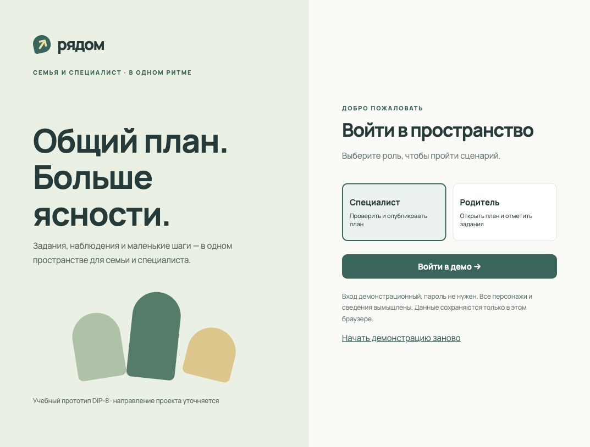

### Профиль и наблюдения специалиста

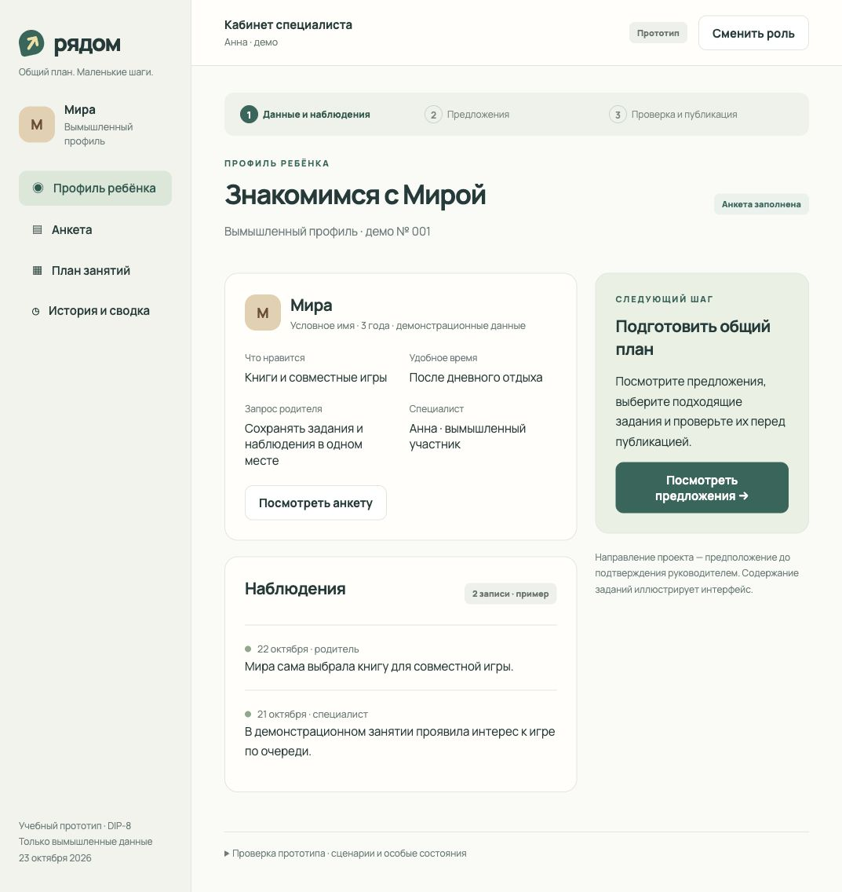

### Заполнение анкеты родителем

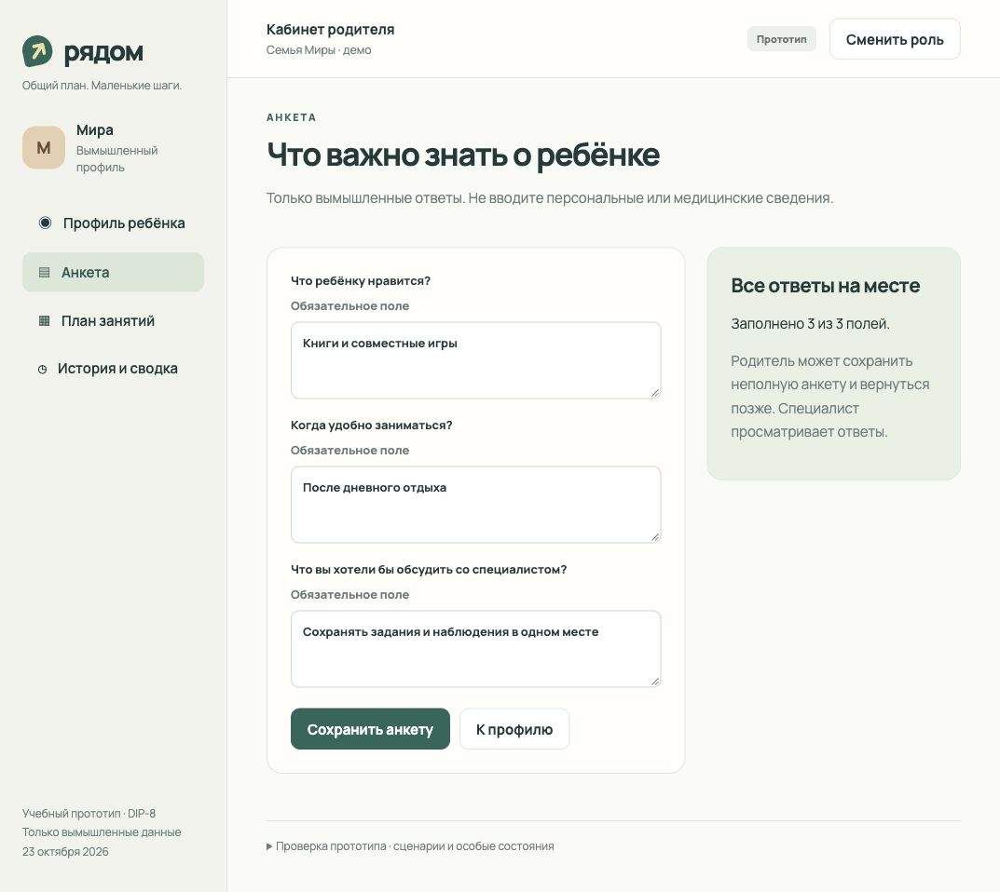

### Предложения с объяснениями

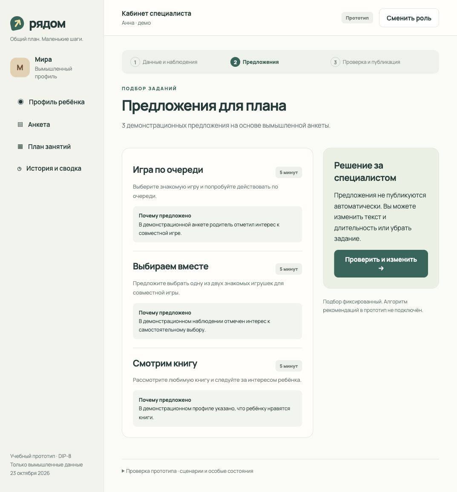

### Проверка, редактирование и публикация

На снимке также видно сообщение, возникающее при попытке публикации без подтверждения проверки.

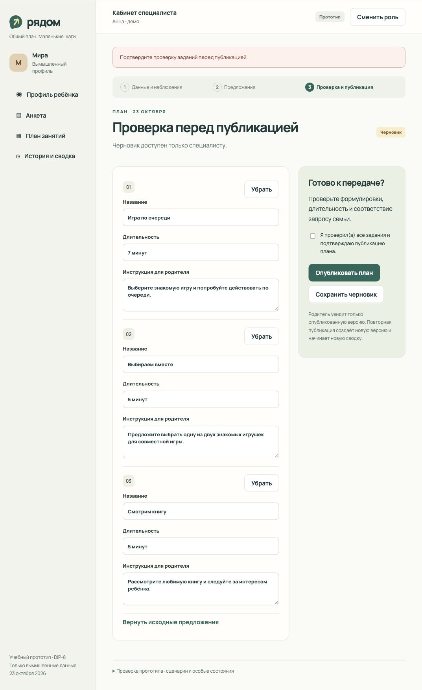

### Опубликованный план у специалиста

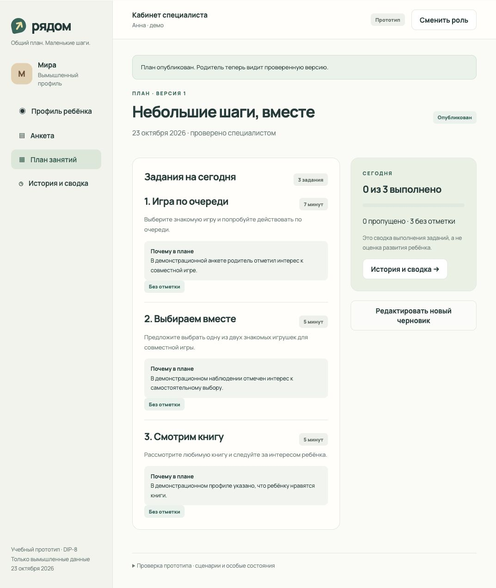

### Опубликованный план и отметки родителя

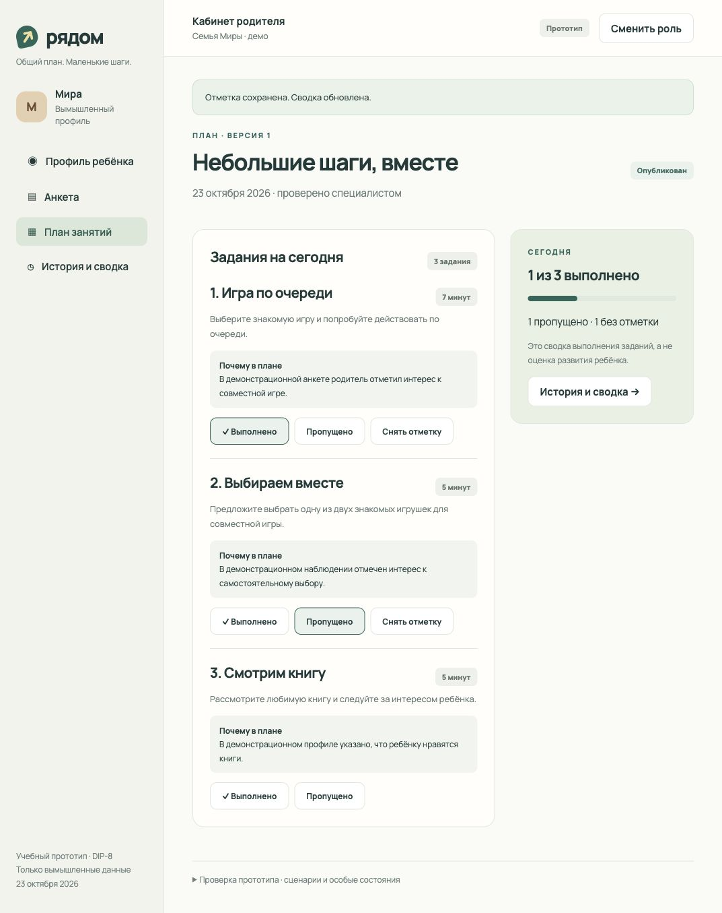

### История и сводка

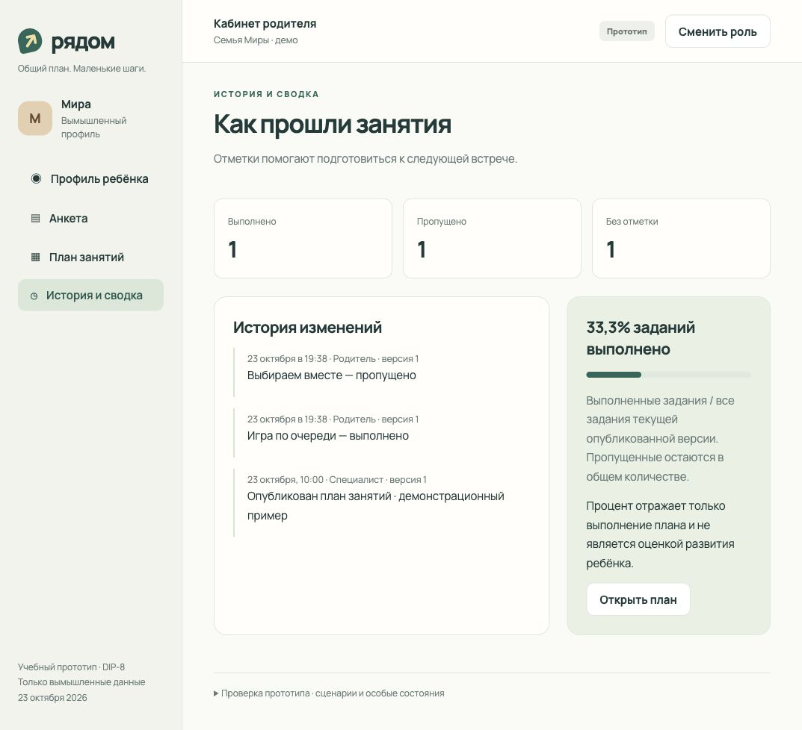

### Неполная анкета

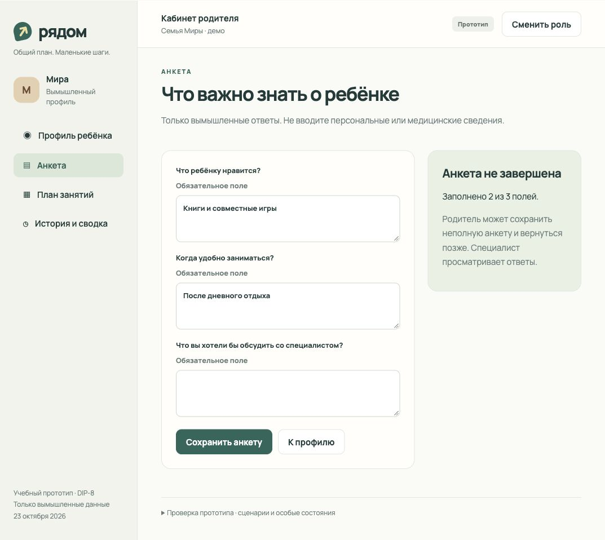

### Отсутствие опубликованного плана

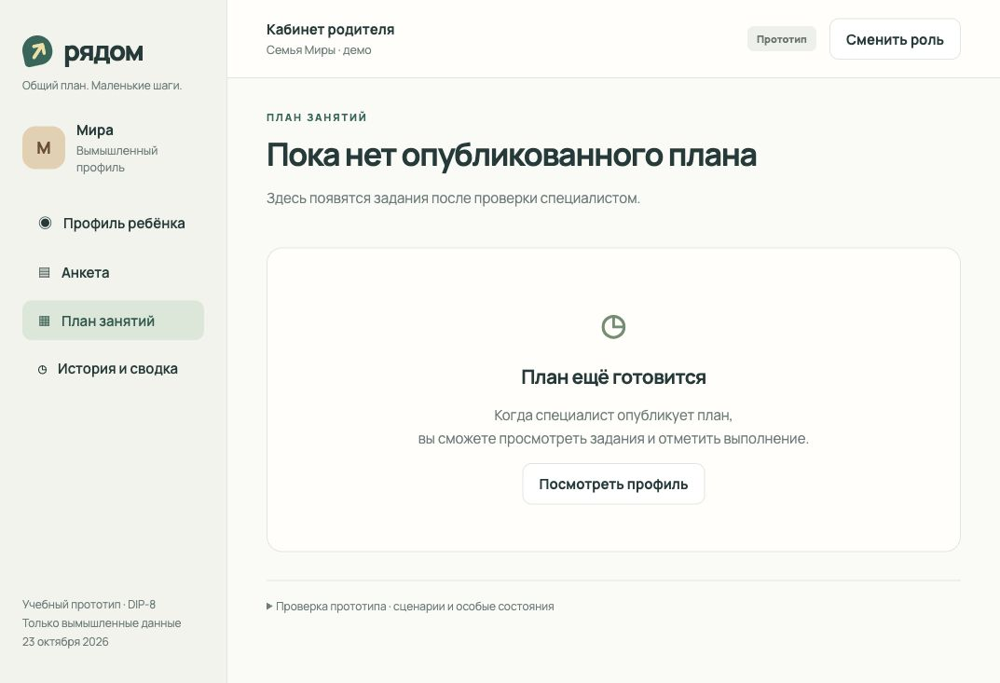

### Ошибка сохранения

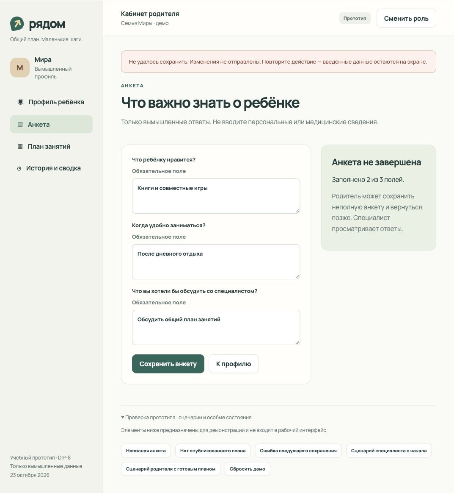

## Что реализовано

- Переходы между всеми девятью запрошенными типами экранов.
- Демонстрационный вход и смена роли для последовательного показа сценариев.
- Просмотр профиля и наблюдений, заполнение и сохранение анкеты.
- Фиксированные предложения с объяснениями; редактирование и удаление заданий.
- Раздельные черновик и опубликованный снимок плана; проверка перед публикацией.
- Отметки выполнения и пропуска, снятие отметок, история и пересчёт сводки.
- Три запрошенных особых состояния и повтор после ошибки.
- Локальное сохранение в браузере; вёрстка с адаптивными правилами.

## Что пока не реализовано

- Реальная аутентификация, серверная авторизация и права доступа. Разделение ролей здесь только демонстрация интерфейса; нельзя применять его для реальных данных.
- Backend, общая база, синхронизация между пользователями и устройствами, интеграция с работающим продуктом.
- Динамический алгоритм рекомендаций, клиническая оценка или оценка развития.
- Создание нескольких профилей, редактирование наблюдений, приглашения специалистов, уведомления.
- Календарь повторяющихся заданий, архив полных старых планов и восстановление версий. Повторная публикация начинает новую сводку; журнал предыдущих действий сохраняется.
- Пользовательское тестирование с реальными представителями аудитории.
- Доступ команды к размещённому прототипу ещё требует настройки; приватная ссылка доступна владельцу. Исходники и снимки передаются в общем репозитории через отдельный PR с DIP-8.

## Сопоставление с текущими требованиями

Основание: [docs/requirements.md](requirements.md), исходная редакция main `90836c4`. Требования имеют статус «Предлагается». Ниже показано покрытие **макетом интерфейса**, а не выполнение всех критериев полноценной платформой.

| Требование | Что показано в DIP-8 | Ограничение / решение для согласования |
| --- | --- | --- |
| FR-02, FR-03 | Вход с выбором демонстрационной роли и разные действия | Аутентификации, серверной проверки доступа и чужих профилей нет |
| FR-05, FR-07 | Просмотр профиля и наблюдений | Создание профиля и добавление наблюдения не реализованы |
| FR-06, FR-11 | Заполнение анкеты, сообщение о неполноте, блокировка предложений | Неполная анкета сохраняется как рабочий ввод; версия структуры и серверная проверка не реализованы. Нельзя считать такой ввод завершённой анкетой по FR-06 |
| FR-08, FR-09, FR-10 | Три предложения с объяснениями | Выдача фиксированная; каталог, правила и персонализация не реализованы |
| FR-12, FR-13 | Редактор, удаление, подтверждение проверки, публикация; отдельный снимок для родителя | Добавление произвольных заданий и серверные права не реализованы |
| FR-14 | Выполнено/пропущено, без повторного события при той же отметке | Необязательный комментарий отсутствует; изменение и снятие отметки — предложение интерфейса, которое ещё нужно согласовать по уточнению к FR-14 |
| FR-15 | Номер опубликованной версии и журнал действий | Полный архив версий и результатов не реализован; повторная публикация сбрасывает текущие отметки. FR-15 не выполнено |
| FR-16 | Числа выполнено/пропущено/без отметки, процент с одним десятичным знаком | Сводка только для текущего локального плана; при отсутствии плана — «Нет назначенных заданий» |
| NFR-03 | Ошибка сохранения и повтор без потери ввода | Ошибка имитируется; API отсутствует |
| NFR-04, NFR-05 | Адаптивная вёрстка, подписи полей и видимый фокус | Полный протокол для 360/1366 px и клавиатуры не выполнен |
| NFR-10 | Все данные вымышлены | Реальные данные детей вводить не нужно |

Отклонения выше не меняют текст требований и не означают их приёмку. Их нужно рассмотреть на командном review перед переходом к реализации.

## Выполненная проверка

Проверено 23.10.2026 в браузере Codex на локальной копии тех же исходных файлов, которые опубликованы. После сверки с требованиями отдельно перепроверено форматирование 33,3% и состояние без плана. Синтаксис JavaScript: `node --check` — успешно; раздача страницы — HTTP 200.

| Проверка | Наблюдаемый результат |
| --- | --- |
| Специалист: профиль → предложения → редактор → публикация | Последовательность пройдена; длительность изменена с 5 до 7 минут и попала в опубликованный план |
| Публикация без подтверждения | Заблокирована, показано сообщение |
| Изоляция черновика | После изменения черновика до 9 минут родитель видит 7 минут; кнопок публикации — 0 |
| Родитель: выполнение и пропуск | Сводка 1 / 1 / 1; в истории 33,3% выполненных заданий |
| Перезагрузка | Отметки и опубликованный план сохранены |
| Неполная анкета | У специалиста кнопка предложений отключена |
| Пустой план | Показано ожидание публикации, без черновика |
| Ошибка сохранения и повтор | Ввод не потерян; повтор показал «Анкета сохранена» |

Снимки получены из реального интерфейса браузера. Визуально проверен экран опубликованного плана. Проверка на физических мобильных устройствах и полноценный аудит доступности не выполнялись.

## Открытые вопросы

1. Подтверждается ли направление ранней помощи? Как называется продукт?
2. Какие поля профиля и анкеты действительно нужны по итогам DIP-2?
3. Кто может приглашать специалиста и связывать его с семьёй?
4. На какой период публикуется план? Как обрабатывать изменения после начала выполнения?
5. Нужны ли причины пропуска, заметки родителя, уведомления и обсуждение заданий?
6. Принимает ли команда сопоставление с FR и перечисленные ниже ограничения этого этапа?
7. Кому предоставить просмотр размещённого прототипа?

**Готовность:** кликабельный макет и документация подготовлены 23 октября, раньше срока 24 октября 10:00 (Asia/Almaty). Передача через общий репозиторий, доступ команды и ревью ещё не завершены. DIP-8 не помечен закрытым.
